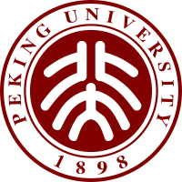
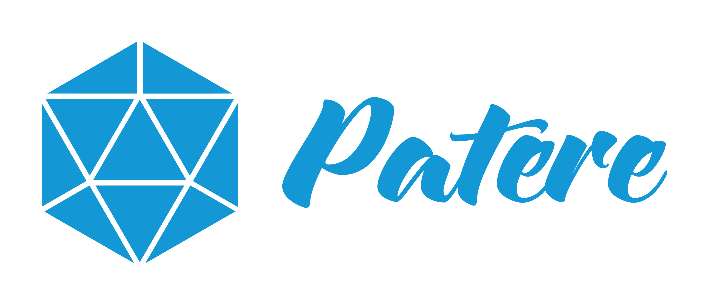

**Huai-Yuan (Hamilton) Chang**

New Taipei, Taiwan · +886 934 027 001 · hamiltonchangwork@gmail.com · hamiltonchang@pku.edu.cn

[LinkedIn](https://www.linkedin.com/in/huai-yuan-chang-63074517a/)

**AI R&D Manager | Computer Vision · Edge AI · ML Systems**

## Education

- **Peking University — M.E. in Software Engineering**, Sept. 2017 – Aug. 2020 
- **Chung Yuan Christian University — B.S. in Computer Science and Information Engineering**, Sept. 2013 – June 2017 

## Professional Summary

Hands-on AI R&D manager leading approximately 6–7 engineers, with experience developing commercial computer vision systems across model training, evaluation, inference optimization, edge deployment, and API integration. Background spans object detection, person Re-ID, tracking, and face recognition, with deployment experience on NVIDIA Jetson and MediaTek platforms. Combines direct engineering contributions with technical decision-making, resource allocation, project planning, delegation, mentoring, and personnel decisions. Brings relevant experience for leading a small ML/CV team delivering video analytics under hardware and real-world scene constraints; additional hands-on experience building internal RAG systems for engineering knowledge.

## Experience

### **ioNetworks — New Taipei, Taiwan** 

**Assistant Technical Manager (AI R&D Department Lead)** · Oct. 2025 – Present

- Lead approximately 6–7 engineers across CV model development, edge deployment, APIs/SDKs, and AI service integration while remaining involved in architecture and implementation.
- Own technical decisions and resource allocation, translating project requirements into technical solutions, work assignments, and delivery plans.
- Make personnel decisions and mentor engineers through 1-on-1s, assignments aligned with development goals, and opportunities for senior engineers to lead projects.
- Establish explicit project owners, multi-engineer collaboration, regular progress discussions, and development, testing, and documentation expectations to support maintainability and knowledge transfer.
- Collaborate with application engineering and SQA on integration and validation; contribute to reusable development tooling and shared AI services.

**Senior AI Algorithm Engineer** · Oct. 2022 – Oct. 2025

- Developed commercial CV capabilities covering object detection, person Re-ID, face recognition, and edge inference, connecting model development with deployment and product integration.
- Contributed to the MediaTek Re-ID project through model development, edge deployment, and internal training/evaluation tooling; the project was demonstrated at ISC 2024.
- Developed a YOLOv10 training framework incorporating knowledge distillation and unlabeled learning to improve detection performance.
- Optimized inference using TensorRT, CUDA/PyCUDA, shared-memory integration, and deployment architecture; worked on GPU-based NMS for NVIDIA Jetson.
- Worked with tracking approaches including OpenPose with KCF and ByteTrack, and with DeepStream-based video analytics development.

### **Infortrend Technology — New Taipei, Taiwan** 

**AI Research and Development Engineer** · May 2021 – July 2022

- Led development of an AI Service API platform and built AI inference services for application integration.
- Developed and improved face detection and recognition capabilities, and optimized NVIDIA Jetson inference using TensorRT/CUDA.
- Developed an ML-based Auto Tiering model for storage workload optimization.

### **Earlier Experience**

- **Patere Technologies, Inc. — Computer Vision Engineer** 
- **Lenovo Research — Computer Vision & AI Algorithm Intern** 
- **Zero Zero Robotics — Computer Vision & AI Algorithm Intern** 

## Selected Projects

**Person Re-ID on MediaTek Edge Hardware — ioNetworks**

- Worked across model development, training/evaluation tools, and on-device deployment. Evaluated performance under controlled and more challenging scenes, building experience connecting model behavior with deployment conditions.

**CV Inference and Service Integration — ioNetworks**

- Worked on detection/recognition inference, TensorRT optimization, shared-memory integration, and API/SDK delivery. Combined model and system-level engineering to address hardware constraints and application integration.

**Internal Engineering RAG — ioNetworks**

- Built an internal RAG system for engineering documents and code using dense, sparse, and graph retrieval, with heterogeneous knowledge stores and dynamic routing.
- Contributed directly to indexing, retrieval, routing, and answer-service implementation; evaluated architectural tradeoffs around extensibility, debugging, and maintenance.

## Skills

- **Leadership:** Technical decision-making, resource allocation, project ownership, task allocation, mentoring, personnel decisions, cross-functional collaboration.
- **Computer Vision:** Object detection, person Re-ID, tracking, face recognition, OpenCV, model evaluation and scene-based error analysis.
- **ML Development:** Python, C++, SQL, PyTorch, TensorFlow, knowledge distillation, unlabeled learning.
- **Edge AI & Optimization:** NVIDIA Jetson, MediaTek, TensorRT, ONNX, CUDA/PyCUDA, DeepStream, TFLite, XNNPACK.
- **ML Systems:** FastAPI, Docker, Kubernetes, Linux, GitLab CI, inference APIs/SDKs, shared-memory integration.
- **LLM/RAG:** Hybrid retrieval, GraphRAG, Neo4j, Qdrant, SQLite, vLLM.

<!-- Editorial notes: Earlier-role dates were absent from the source template. Logo references are preserved from the template; the source image files were not available. Oct. 2025 is retained as the role-transition month from the template. Unverified metric definitions, large-scale deployment counts, camera-calibration expertise, and production monitoring/rollout ownership are intentionally not asserted. -->
