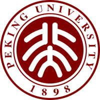
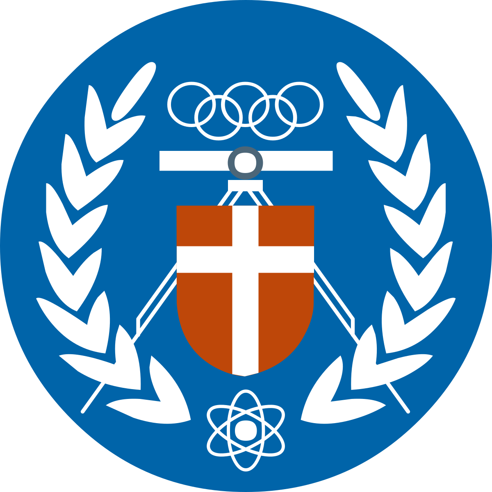
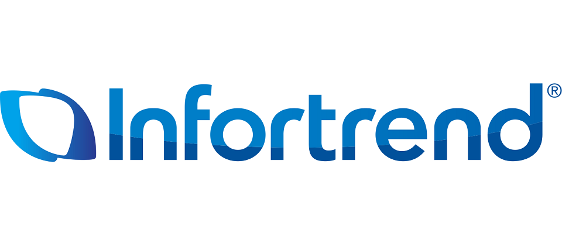
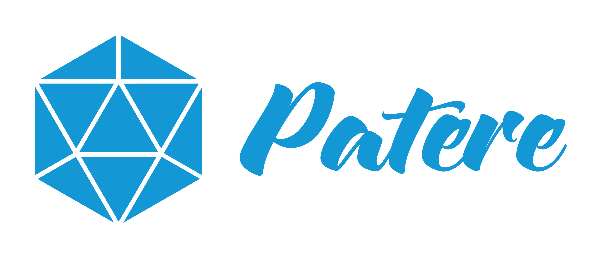

**Huai-Yuan (Hamilton) Chang**

New Taipei, Taiwan · +886 934 027 001 · hamiltonchangwork@gmail.com · hamiltonchang@pku.edu.cn

[LinkedIn](https://www.linkedin.com/in/huai-yuan-chang-63074517a/)

**AI R&D Manager | Computer Vision · Edge AI · ML Systems**

## Education

- **Peking University — M.E. in Software Engineering**, Sept. 2017 – Aug. 2020 
- **Chung Yuan Christian University — B.S. in Computer Science and Information Engineering**, Sept. 2013 – June 2017 

## Professional Summary

Hands-on AI R&D manager leading approximately 6–7 engineers, with experience developing commercial computer vision systems across model training, evaluation, inference optimization, edge deployment, and API integration. Background spans object detection, person Re-ID, tracking, and face recognition, with deployment experience on NVIDIA Jetson and MediaTek platforms. Combines direct engineering contributions with technical decision-making, resource allocation, project planning, delegation, mentoring, and personnel decisions. Brings relevant experience for leading a small ML/CV team delivering video analytics under hardware and real-world scene constraints; additional hands-on experience building internal RAG systems for engineering knowledge.

## Experience

### **ioNetworks — New Taipei, Taiwan** 

**Assistant Technical Manager (AI R&D Department Lead)** · Oct. 2025 – Present

- Lead approximately **6–7 AI R&D engineers**, owning technical decisions, resource allocation, and delivery. Make personnel decisions, mentor through 1-on-1s and delegated project ownership, and remain involved in architecture and core development.
- Led refactoring, official releases, and ongoing optimization of **AIONXIS AI modules (DeepStream) and LumeFace AI services (Triton, RESTful API, and AI SDK)**; LumeFace API is also offered as a standalone product.
- Led on-schedule delivery of **2 detection capabilities—protective clothing and fall detection—for AIONXIS v1.2**, meeting release quality requirements.
- Directed **LumeFace AI SDK edge optimization and platform porting**: reduced face detection / face embedding inference on MTK Genio 700 from **133 / 228 ms on CPU to 9 / 19 ms on NPU**, approximately **14.8× / 12× faster**. Completed porting to Qualcomm RB3 with inference times of **31 / 13.5 ms**, respectively. Measurements cover model inference only; both platforms passed internal acceptance testing.
- Planned and led **4 developers to deliver Phase 1 of Local Engineering Agent in approximately 2–3 months** for internal multi-user use, integrating personal agents and memory, MCP/RAG access controls, online knowledge updates, and department-specific GitLab tools.

**Senior AI Algorithm Engineer** · Oct. 2022 – Oct. 2025

- Developed commercial CV capabilities covering object detection, person Re-ID, face recognition, and edge inference, connecting model development with deployment and product integration.
- Contributed to the MediaTek Re-ID project through model development, edge deployment, and internal training/evaluation tooling; the project was demonstrated at ISC 2024.
- Developed a YOLOv10 training framework incorporating knowledge distillation and unlabeled learning to improve detection performance.
- Optimized inference using TensorRT, CUDA/PyCUDA, shared-memory integration, and deployment architecture; worked on GPU-based NMS for NVIDIA Jetson.
- Worked with tracking approaches including OpenPose with KCF and ByteTrack, and with DeepStream-based video analytics development.

### **Infortrend Technology — New Taipei, Taiwan** 

**AI Research and Development Engineer** · May 2021 – July 2022

- Led development of an AI Service API platform and built AI inference services for application integration.
- Developed and improved face detection and recognition capabilities, and optimized NVIDIA Jetson inference using TensorRT/CUDA.
- Developed an ML-based Auto Tiering model for storage workload optimization.

### **Earlier Experience**

- **Patere Technologies, Inc. — Computer Vision Engineer** 
- **Lenovo Research — Computer Vision & AI Algorithm Intern** 
- **Zero Zero Robotics — Computer Vision & AI Algorithm Intern** 

## Selected Projects

**Person Re-ID on MediaTek Edge Hardware — ioNetworks**

- Worked across model development, training/evaluation tools, and on-device deployment. Evaluated performance under controlled and more challenging scenes, building experience connecting model behavior with deployment conditions.

**AIONXIS and LumeFace AI Product Delivery — ioNetworks**

- Led refactoring and releases of DeepStream AI modules and Triton / RESTful API / AI SDK services, connecting models, inference services, and application integration; delivered protective clothing and fall detection for AIONXIS v1.2.
- Directed Genio 700 NPU optimization and Qualcomm RB3 porting against edge performance and recognition-quality requirements; both platforms passed internal acceptance testing.

**Local Engineering Agent and Internal Knowledge Platform — ioNetworks**

- Led 4 developers to complete Phase 1 in approximately 2–3 months for internal use, providing a multi-user interface, individual agents and separate memory, and MCP tool / RAG access controls.
- Delivered online RAG updates and unified document management with user-controlled sharing within departments, plus department-specific GitLab knowledge stores and tools.
- Additional hands-on internal document/code RAG experience includes dense, sparse, and graph retrieval, heterogeneous stores, dynamic routing, indexing, retrieval, and answer services.

## Skills

- **Leadership:** Technical decision-making, resource allocation, project ownership, task allocation, mentoring, personnel decisions, cross-functional collaboration.
- **Computer Vision:** Object detection, person Re-ID, tracking, face recognition, OpenCV, model evaluation and scene-based error analysis.
- **ML Development:** Python, C++, SQL, PyTorch, TensorFlow, knowledge distillation, unlabeled learning.
- **Edge AI & Optimization:** NVIDIA Jetson, MediaTek, TensorRT, ONNX, CUDA/PyCUDA, DeepStream, TFLite, XNNPACK.
- **ML Systems:** FastAPI, Docker, Kubernetes, Linux, GitLab CI, inference APIs/SDKs, shared-memory integration.
- **LLM/RAG:** Hybrid retrieval, GraphRAG, Neo4j, Qdrant, SQLite, vLLM.

<!-- Resume version: v0.5. Original template logo paths retained; source assets and earlier-role dates remain unavailable. -->
