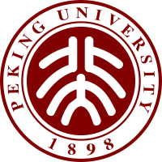
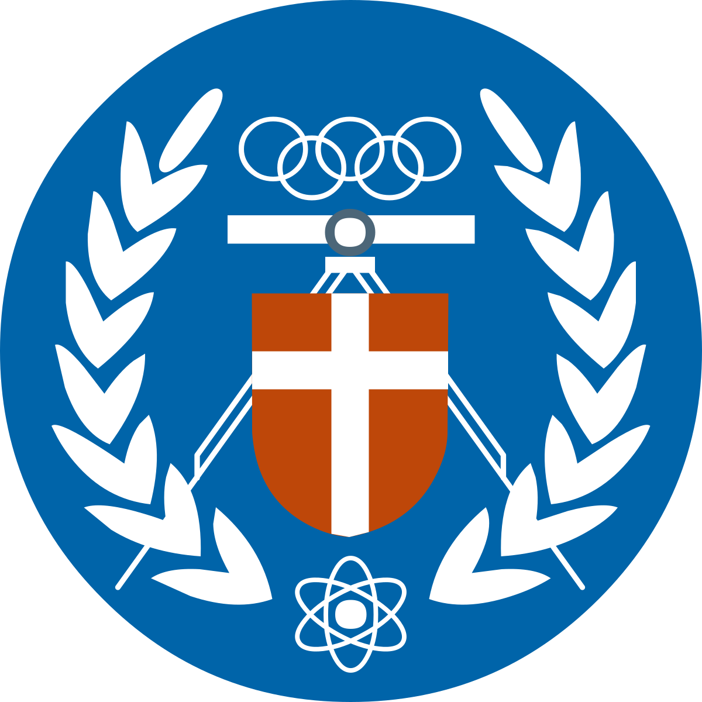
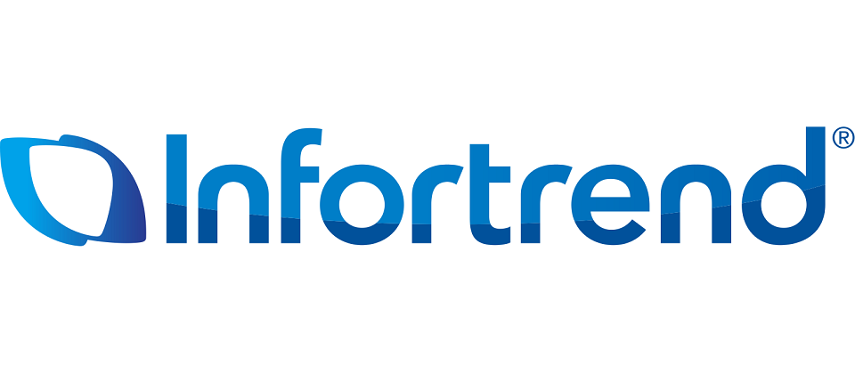
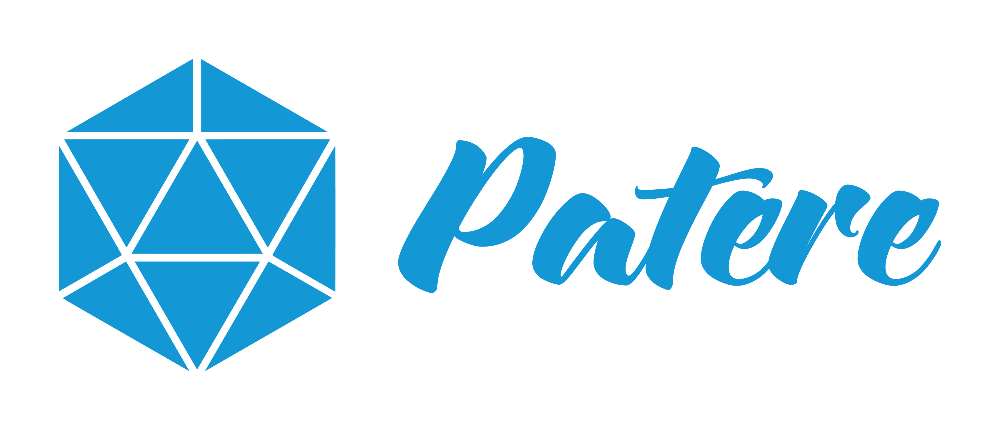

**張懷元 Huai-Yuan (Hamilton) Chang**

新北市，台灣 · +886 934 027 001 · hamiltonchangwork@gmail.com · hamiltonchang@pku.edu.cn

[LinkedIn](https://www.linkedin.com/in/huai-yuan-chang-63074517a/)

**AI 研發主管｜電腦視覺 · Edge AI · ML 系統開發**

## 學歷

- **北京大學｜軟體工程碩士**，2017.09 – 2020.08 
- **中原大學｜資訊工程學士**，2013.09 – 2017.06 

## 專業摘要

兼具實作與團隊管理經驗的 AI 研發主管，帶領約 6–7 人團隊，具備商用電腦視覺系統開發經驗，涵蓋模型訓練、評估、推論優化、邊緣部署與 API 整合。技術背景包括物件偵測、行人再識別（Re-ID）、追蹤及人臉辨識，曾於 NVIDIA Jetson、MediaTek 平台進行部署。持續參與架構與程式開發，同時負責技術決策、資源配置、專案規劃、分工授權、人才培育及人事決策。可將 CV 模型與硬體限制、實際場景需求結合，帶領小型 ML/CV 團隊推進影像分析產品；另具內部工程知識 RAG 系統的實際建置經驗。

## 工作經歷

### **ioNetworks｜台灣，新北市** 

**Assistant Technical Manager（AI 演算法研發部門主管）**｜2025.10 – 至今

- 帶領約 6–7 人團隊，工作涵蓋 CV 模型研發、Edge 部署、API/SDK 與 AI 服務整合，並持續參與系統架構與核心實作。
- 主導技術決策與資源配置，將專案需求轉為技術方案、工作分配與交付規劃。
- 負責人事決策，透過 1-on-1、結合成員發展目標的任務安排，以及資深工程師主導專案的機會，培育團隊能力。
- 建立明確專案主導人、多人協作、例行進度討論，以及開發、測試與文件要求，支援後續維護及知識交接。
- 與應用工程及 SQA 協作進行整合、驗證，參與可重用開發工具與共用 AI 服務建置。

**Senior AI Algorithm Engineer（資深 AI 演算法工程師）**｜2022.10 – 2025.10

- 開發物件偵測、行人 Re-ID、人臉辨識與 Edge 推論能力，串接模型研發、平台部署及產品整合。
- 參與 MediaTek 平台 Re-ID 專案，涵蓋模型開發、邊緣部署與內部訓練／評估工具；專案於 ISC 2024 展示。
- 開發結合知識蒸餾與未標註資料學習的 YOLOv10 訓練框架，改善偵測模型表現。
- 使用 TensorRT、CUDA/PyCUDA、共享記憶體整合及部署架構進行推論優化，並開發 NVIDIA Jetson 的 GPU NMS 處理。
- 具備 OpenPose 搭配 KCF、ByteTrack 等追蹤方法，以及 DeepStream 影像分析開發經驗。

### **Infortrend Technology｜台灣，新北市** 

**AI Research and Development Engineer（AI 研發工程師）**｜2021.05 – 2022.07

- 主導 AI Service API 平台開發，建置供應用系統整合的 AI 推論服務。
- 開發與改善人臉偵測、辨識能力，使用 TensorRT/CUDA 優化 NVIDIA Jetson 推論。
- 開發以機器學習進行儲存工作負載優化的 Auto Tiering 模型。

### **早期經歷**

- **Patere Technologies, Inc.｜Computer Vision Engineer** 
- **Lenovo Research｜Computer Vision & AI Algorithm Intern** 
- **Zero Zero Robotics｜Computer Vision & AI Algorithm Intern** 

## 精選專案

**MediaTek 邊緣平台行人 Re-ID｜ioNetworks**

- 參與模型開發、訓練／評估工具與裝置端部署，對照受控條件及較困難場景下的表現，累積將模型行為與實際部署情境連結的經驗。

**CV 推論與服務整合｜ioNetworks**

- 參與偵測／辨識推論、TensorRT 優化、共享記憶體整合及 API/SDK 交付，同時從模型與系統層面處理硬體限制及應用介接需求。

**內部工程知識 RAG｜ioNetworks**

- 實際建置處理工程文件與程式碼的內部 RAG，採 dense、sparse 與 graph 混合檢索，結合異質知識庫及動態路由。
- 親自參與索引、檢索、路由與回答服務實作，評估架構擴充、除錯及維護的取捨。

## 專業技能

- **技術與團隊管理：** 技術決策、資源配置、專案責任分工、工作分配、人才培育、人事決策、跨部門協作。
- **電腦視覺：** 物件偵測、行人 Re-ID、追蹤、人臉辨識、OpenCV、模型評估與場景錯誤分析。
- **模型開發：** Python、C++、SQL、PyTorch、TensorFlow、知識蒸餾、未標註資料學習。
- **Edge AI 與效能優化：** NVIDIA Jetson、MediaTek、TensorRT、ONNX、CUDA/PyCUDA、DeepStream、TFLite、XNNPACK。
- **ML 系統：** FastAPI、Docker、Kubernetes、Linux、GitLab CI、推論 API/SDK、共享記憶體整合。
- **LLM/RAG：** 混合檢索、GraphRAG、Neo4j、Qdrant、SQLite、vLLM。

<!-- 編輯註記：原始模板未提供早期職務日期；保留原模板 Logo 引用，但未取得圖片原檔。職務轉換月份依原模板保留為 2025.10。未將指標定義尚未確認的數字、千店部署、相機校正專長、正式環境模型監控或漸進上線責任寫為既有成就。 -->
