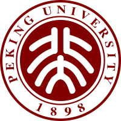
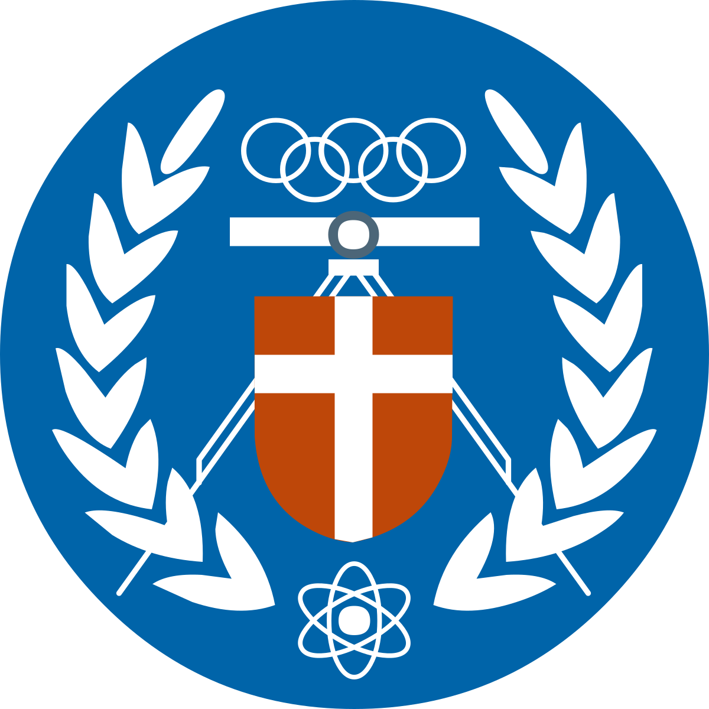
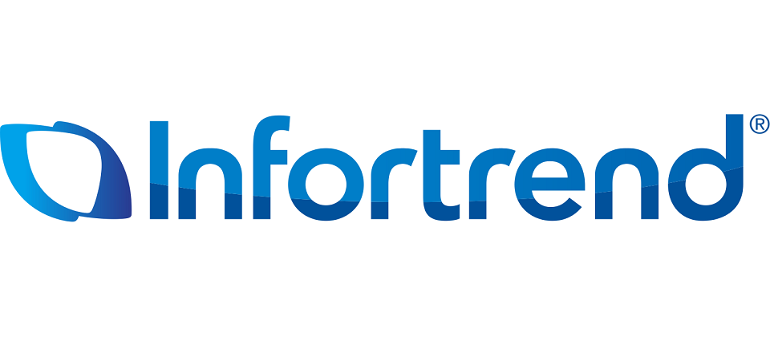
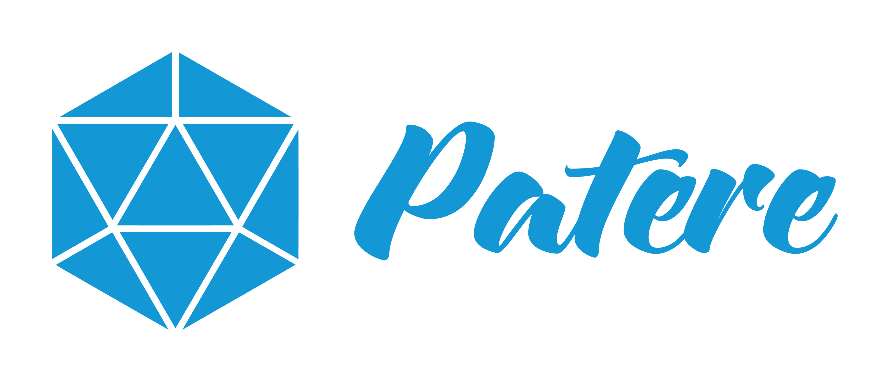
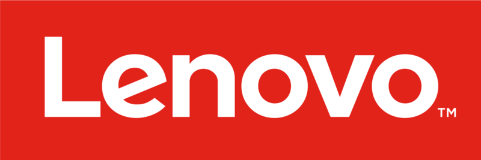
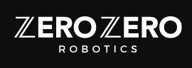

**張懷元 Huai-Yuan (Hamilton) Chang**

新北市，台灣 · +886 934 027 001 · hamiltonchangwork@gmail.com · hamiltonchang@pku.edu.cn

[LinkedIn](https://www.linkedin.com/in/huai-yuan-chang-63074517a/)

**AI 研發主管｜電腦視覺 · Edge AI · ML 系統開發**

## 學歷

- **北京大學｜軟體工程碩士**，2017.09 – 2020.08 
- **中原大學｜資訊工程學士**，2013.09 – 2017.06 

## 專業摘要

兼具實作與團隊管理經驗的 AI 研發主管，帶領約 6–7 人團隊，具備商用電腦視覺系統開發經驗，涵蓋模型訓練、評估、推論優化、邊緣部署與 API 整合。技術背景包括物件偵測、行人再識別（Re-ID）、追蹤及人臉辨識，曾於 NVIDIA Jetson、MediaTek 平台進行部署。持續參與架構與程式開發，同時負責技術決策、資源配置、專案規劃、分工授權、人才培育及人事決策。可將 CV 模型與硬體限制、實際場景需求結合，帶領小型 ML/CV 團隊推進影像分析產品；另具內部工程知識 RAG 系統的實際建置經驗。

## 工作經歷

### **ioNetworks｜台灣，新北市** 

**Assistant Technical Manager（AI 演算法研發部門主管）**｜2025.10 – 至今

- 帶領約 **6–7 人 AI 研發團隊**，主導技術決策、資源配置與專案交付；負責人事決策，透過 1-on-1 與專案授權培育成員，持續參與架構與核心開發。
- 主導 **AIONXIS AI 模組（DeepStream）與 LumeFace AI 服務（Triton、RESTful API、AI SDK）** 的重構、正式發佈與持續優化；LumeFace API 亦作為獨立產品提供服務。
- 帶領團隊於 **AIONXIS v1.2 如期完成防塵服與跌倒偵測 2 項功能**交付，達成版本品質要求。
- 主導 **LumeFace AI SDK Edge 推論優化與跨平台移植**：MTK Genio 700 的人臉偵測／特徵抽取由 CPU 的 **133／228 ms** 降至 NPU 的 **9／19 ms**，分別約 **14.8／12 倍加速**；完成 Qualcomm RB3 移植，推論時間分別為 **31／13.5 ms**。上述時間僅含模型推論，兩平台皆通過內部驗收。
- 主導規劃、分工並帶領 **4 位開發人員，於約 2–3 個月完成 Local Engineering Agent 第一階段**，供內部多人使用，整合個人 Agent／記憶、MCP／RAG 權限、線上知識更新與部門 GitLab 工具。

**Senior AI Algorithm Engineer（資深 AI 演算法工程師）**｜2022.10 – 2025.10

- 開發物件偵測、行人 Re-ID、人臉辨識與 Edge 推論能力，串接模型研發、平台部署及產品整合。
- 參與 MediaTek 平台 Re-ID 專案，涵蓋模型開發、邊緣部署與內部訓練／評估工具；專案於 ISC 2024 展示。
- 開發結合知識蒸餾與未標註資料學習的 YOLOv10 訓練框架，改善偵測模型表現。
- 使用 TensorRT、CUDA/PyCUDA、共享記憶體整合及部署架構進行推論優化，並開發 NVIDIA Jetson 的 GPU NMS 處理。
- 具備 OpenPose 搭配 KCF、ByteTrack 等追蹤方法，以及 DeepStream 影像分析開發經驗。

### **Infortrend Technology｜台灣，新北市** 

**AI Research and Development Engineer（AI 研發工程師）**｜2021.05 – 2022.07

- 主導 AI Service API 平台開發，建置供應用系統整合的 AI 推論服務。
- 開發與改善人臉偵測、辨識能力，使用 TensorRT/CUDA 優化 NVIDIA Jetson 推論。
- 開發以機器學習進行儲存工作負載優化的 Auto Tiering 模型。

### **早期經歷**

- **Patere Technologies, Inc.｜Computer Vision Engineer** 
- **Lenovo Research｜Computer Vision & AI Algorithm Intern** 
- **Zero Zero Robotics｜Computer Vision & AI Algorithm Intern** 

## 精選專案

**MediaTek 邊緣平台行人 Re-ID｜ioNetworks**

- 參與模型開發、訓練／評估工具與裝置端部署，對照受控條件及較困難場景下的表現，累積將模型行為與實際部署情境連結的經驗。

**AIONXIS 與 LumeFace AI 產品交付｜ioNetworks**

- 主導 DeepStream AI 模組及 Triton／RESTful API／AI SDK 服務重構與發佈，串接模型、推論服務與應用整合；完成 AIONXIS v1.2 防塵服與跌倒偵測功能交付。
- 依 Edge 裝置的效能與辨識品質需求，主導 Genio 700 NPU 部署優化及 Qualcomm RB3 移植，通過內部驗收。

**Local Engineering Agent 與內部知識平台｜ioNetworks**

- 帶領 4 人於約 2–3 個月完成第一階段並供內部使用，提供多人介面、個人 Agent 與獨立記憶，以及 MCP 工具與 RAG 存取權限。
- 支援線上 RAG 更新與統一文件管理，使用者可決定文件是否分享給同部門人員；整合部門 GitLab 知識庫與工具。
- 另具內部文件／程式碼 RAG 實作經驗，涵蓋 dense、sparse、graph 混合檢索、異質知識庫、動態路由，以及索引、檢索與回答服務。

## 專業技能

- **技術與團隊管理：** 技術決策、資源配置、專案責任分工、工作分配、人才培育、人事決策、跨部門協作。
- **電腦視覺：** 物件偵測、行人 Re-ID、追蹤、人臉辨識、OpenCV、模型評估與場景錯誤分析。
- **模型開發：** Python、C++、SQL、PyTorch、TensorFlow、知識蒸餾、未標註資料學習。
- **Edge AI 與效能優化：** NVIDIA Jetson、MediaTek、TensorRT、ONNX、CUDA/PyCUDA、DeepStream、TFLite、XNNPACK。
- **ML 系統：** FastAPI、Docker、Kubernetes、Linux、GitLab CI、推論 API/SDK、共享記憶體整合。
- **LLM/RAG：** 混合檢索、GraphRAG、Neo4j、Qdrant、SQLite、vLLM。

<!-- Resume version: v0.5. Original template logo paths retained; source assets and earlier-role dates remain unavailable. -->
